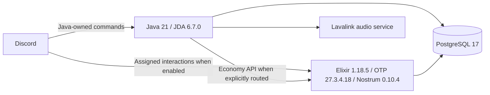
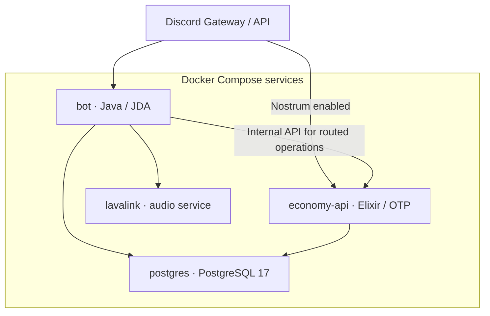

# Tori

[](https://openjdk.org/projects/jdk/21/)
[](https://github.com/discord-jda/JDA)
[](https://elixir-lang.org/)
[](https://www.erlang.org/)
[](https://hexdocs.pm/nostrum/0.10.4/)
[](https://www.postgresql.org/)
[](https://gradle.org/)
[](https://lavalink.dev/)
[](LICENSE)
[](https://github.com/Reina-Kousaka1/Tori/pulls)

Tori is a hybrid Discord bot built with Java/JDA and Elixir/OTP. Java owns the established runtime—including music through Lavalink, moderation, tickets and orders—while Elixir/Nostrum provides the internal Economy API and specifically assigned Discord interactions. Both runtimes use PostgreSQL as the persistent source of truth.

**Navigation:** [Overview](#about) · [Features](#features) · [Architecture](#architecture) · [Development](#development) · [Java & Docker guide](Tori/README.md) · [Contributing](CONTRIBUTING.md) · [Security](SECURITY.md) · [License](LICENSE)

## About

This repository contains Tori's Java Discord runtime and an Elixir/OTP domain service. Java/JDA continues to own its established bot runtime, including music and Lavalink. Elixir/Nostrum handles a limited set of explicitly assigned main-bot interactions and provides newer domain capabilities. Both applications use the same PostgreSQL database; Elixir is not a second economy datastore.

Several Elixir mutation paths are implemented but remain gated from production writes. A feature present in source code is not necessarily enabled in a running deployment. See [the Economy V2 guide](Tori/economy-v2/README.md) and [rewrite status](Tori/docs/ELIXIR-REWRITE-STATUS.md) for current ownership and rollout boundaries.

## Features

| Area | Implemented functionality | Current status |
| --- | --- | --- |
| Music / Lavalink | Java/JDA playback, queues and supported YouTube/Spotify search or links via Lavalink | Java-owned runtime |
| Moderation | Java commands, permission checks, case records and optional webhook mod logs | Java-owned runtime |
| Tickets and orders | Java/JDA ticket and staff-order workflows backed by PostgreSQL | Java-owned runtime |
| Economy | Existing credits, daily/work/activity rewards, transfers, inventory and legacy shop/market commands | Existing Java paths remain active; Economy V2 routing defaults to `LEGACY` |
| Shop / marketplace | Elixir catalog, featured rotation, catalog purchases and escrow marketplace operations; optional Nostrum `/shop` UI | Implemented, but new Elixir mutations are blocked by the production WriteGate |
| Inventory / equipment | Elixir inventory, wardrobe, equipment slots, cosmetic selections and consumables | Implemented; mutation paths remain gated |
| Careers and profiles | Elixir Ballet, Volleyball and Cheer progression plus a read-only profile aggregator | `/career` and `/profile` are Elixir/Nostrum-owned when enabled; career writes remain gated |
| Relationships | Elixir marriage and relationship domain with `/marry`, `/divorce` and `/marriage` interactions | Implemented; writes remain gated |
| Persona and presence | Elixir provides semantic context; Java selects and writes the actual Discord presence | Java remains the only presence writer |
| AutoMod | Optional per-guild detection for join bursts, floods, mention spam and invite links | Experimental, disabled by default, detection-only; it does not take moderation actions |

Nostrum is disabled by default. When enabled, it uses the existing main-bot `DISCORD_TOKEN` and configured `DISCORD_GUILD_ID`; its registrar is limited to assigned Elixir commands. The optional Elixir `/shop` command requires `TORI_NOSTRUM_SHOP_ENABLED=true` as well and explicitly transfers ownership of that command.

## Architecture

| Component | Responsibility |
| --- | --- |
| Java / JDA | Established Discord runtime, existing Java commands, music/Lavalink, moderation, tickets, orders, technical presence writing and legacy economy paths |
| Elixir / OTP / Nostrum | Internal Economy API, supervised domain services, and the specifically assigned Elixir Discord interactions |
| PostgreSQL | The single authoritative persistent database shared by both applications; Flyway migrations live under `Tori/src/main/resources/db/migration` |
| Lavalink | Separate audio service used by the Java music runtime |
| Docker Compose | Local/container orchestration for PostgreSQL, Lavalink, the internal Economy API and the Java bot |

### High-level architecture



### Runtime and service dependencies



The Compose file currently uses the moving `latest` tag for Lavalink, so no Lavalink version badge is shown.

Economy V2 routes default to Java's `LEGACY` implementation. Elixir writes require explicit gates; the Compose defaults disable production writes. Integration tests must use an isolated PostgreSQL database, never production. The repository contains Flyway migrations through V13 and repeatable V12 scripts; their presence in Git does not assert which migrations have been applied by any deployment.

## Repository layout

| Path | Purpose |
| --- | --- |
| [`Tori/src/main/java/music`](Tori/src/main/java/music) | Java bot, commands and Discord integrations |
| [`Tori/economy-v2`](Tori/economy-v2) | Elixir API, domain services, OTP supervision and tests |
| [`Tori/src/main/resources/db/migration`](Tori/src/main/resources/db/migration) | Flyway schema migrations |
| [`Tori/docs`](Tori/docs) | Architecture, migration, validation and release-safety notes |
| [`Tori/compose.yaml`](Tori/compose.yaml) | PostgreSQL, Lavalink, Economy API and bot Compose services |

## Development

Start with [CONTRIBUTING.md](CONTRIBUTING.md) for required runtimes, local setup, architecture rules and test commands. The detailed Java and Docker operations guide is [Tori/README.md](Tori/README.md).

Java checks from `Tori/`:

```sh
./gradlew clean test build --no-daemon
```

Elixir checks from `Tori/economy-v2/`:

```sh
mix deps.get
mix format --check-formatted
mix compile --warnings-as-errors
mix test
```

## Security

Read [SECURITY.md](SECURITY.md) before reporting a vulnerability. Never commit tokens, credentials, `.env` files or private Discord data.

## Community

Participation follows the [Code of Conduct](CODE_OF_CONDUCT.md). See [SUPPORT.md](SUPPORT.md) for the available issue and support paths.

## Contributing

Tori maintainer work is done directly on `main`, without feature or documentation branches or force-pushes. External contributions may be proposed as focused pull requests from a fork. See [CONTRIBUTING.md](CONTRIBUTING.md) and the [pull request template](.github/pull_request_template.md).

## License

Tori is licensed under the [Apache License 2.0](LICENSE).
